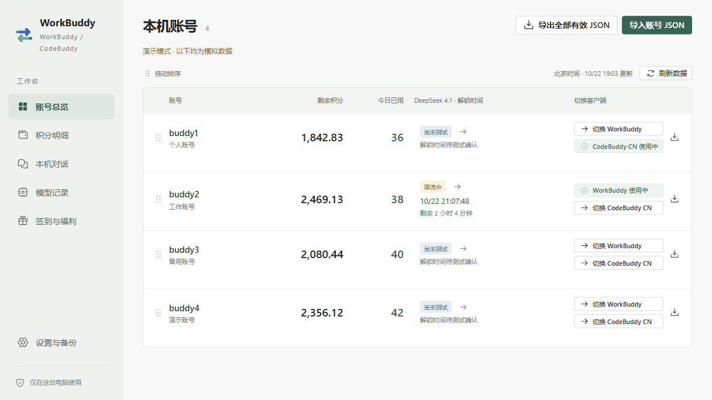
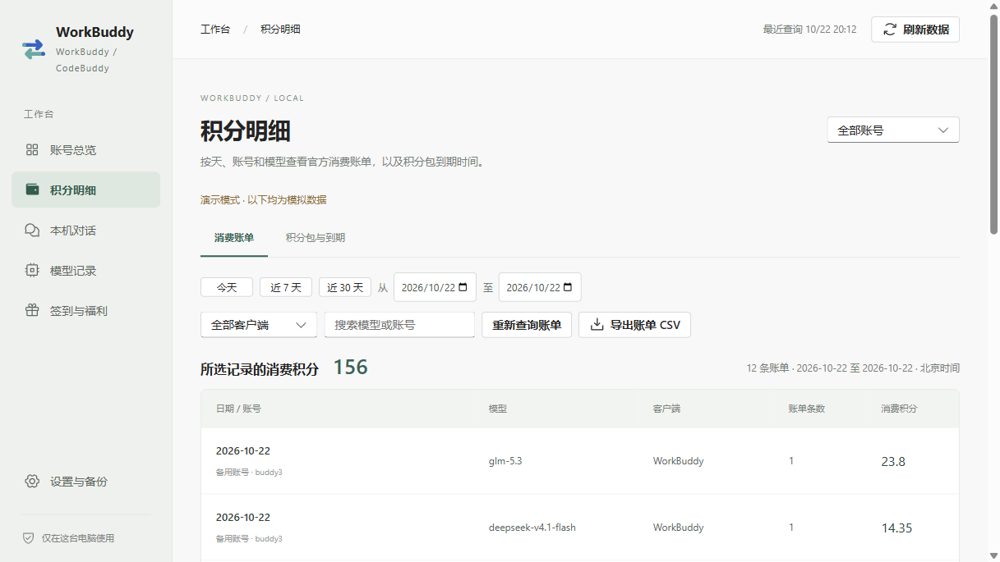
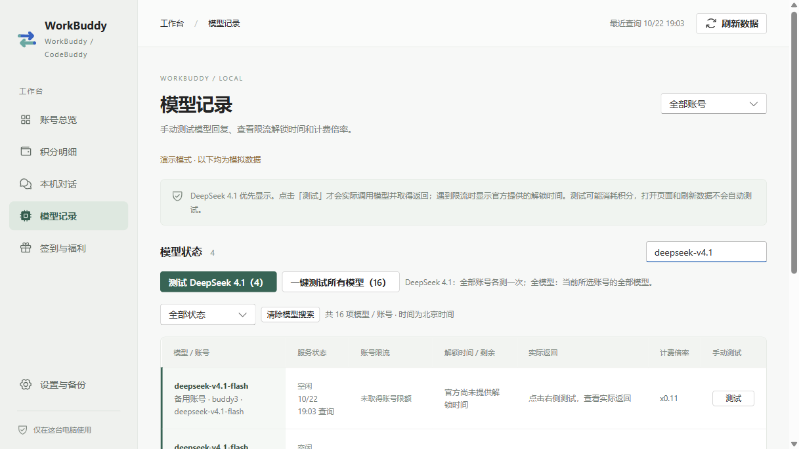
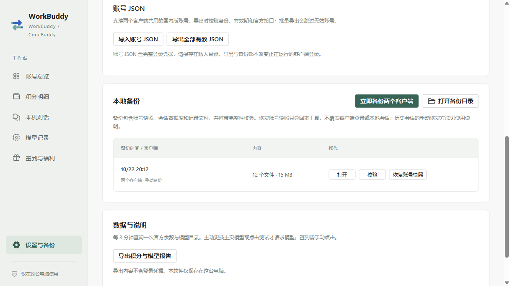

<p align="center"></p>
<h1 align="center">WorkBuddy Switch</h1>
<p align="center">管理 WorkBuddy 与 CodeBuddy CN 账号，查看积分、账单与模型解锁时间。</p>
<p align="center"><a href="https://github.com/3160696/workbuddy-switch/releases/latest">下载 Windows 版</a> · <a href="使用说明.md">使用说明</a> · <a href="#开发">开发</a></p>

当前稳定版：**[v1.1.1](https://github.com/3160696/workbuddy-switch/releases/tag/v1.1.1)** · [对应源码](https://github.com/3160696/workbuddy-switch/tree/v1.1.1) · [更新日志](更新日志.md)

主页模型列现可直接选模型、点「测试」，结果在各账号原位置显示。操作方式见[模型选择与测试](使用说明.md#主页模型选择与测试)。



## 功能

- **双客户端独立切换**：同一份账号列表，分别切换 WorkBuddy / CodeBuddy CN；切换前验证登录、检查任务并备份，失败时回滚。
- **紧凑账号总览**：一屏查看四个账号，拖动排序并自动保存；显示剩余积分、今日已用、所选模型状态及解锁时间。表头选模型后各账号自动测一次，也可点「测试」重测。
- **官方消费账单**：按日期、账号、模型和客户端查看实际积分消费，支持近 7 / 30 天、自选日期及 CSV 导出。
- **手动模型测试**：单项测试、测试所有模型，或只测试各账号的 DeepSeek 4.1；显示回复、错误、官方重置时间和倒计时，支持停止。
- **账号 JSON**：导入时校验身份及官方访问权限；单个或批量导出当时验证有效的完整 JSON。
- **本地会话与备份**：只读浏览对话；支持手动备份、完整性校验和账号快照恢复。
- **签到与福利**：手动查询及领取官方支持的签到、旅行奖励；打开软件和自动刷新不会自动签到或调用模型。

所有截图均由隔离的演示后端生成，不读取真实账号、登录凭据或本机会话。

<details>
<summary>账单、模型与备份截图</summary>





</details>

## 开始使用

支持 **Windows 10 / 11 x64、国内版 WorkBuddy 与 CodeBuddy CN**。这是独立的第三方本地工具，与官方客户端无隶属关系。

1. 从 [Releases](https://github.com/3160696/workbuddy-switch/releases/latest) 下载安装包，或下载 ZIP 后完整解压运行。安装器创建开始菜单入口，默认不创建桌面快捷方式。
2. 在「设置与备份」中选择官方客户端的可执行文件。CodeBuddy CN 需要先使用默认配置登录一次。
3. 保存客户端当前登录，或在主页导入完整账号 JSON。导入本身不会切换或关闭客户端。
4. 完成当前任务、保存编辑器文件后，点击目标账号对应的切换按钮并确认。

WorkBuddy 切换会备份登录与数据库，并将当前账号的本地对话和自动任务归属迁移到目标账号，保留内容与删除标记。CodeBuddy 使用自己的 Windows 加密存储，仅替换登录项，保留编辑器和会话数据；不迁移 CodeBuddy 的会话归属。退出被阻止时会中止切换。

## 数据说明

- 今日已用来自北京时间当天的官方逐条消费账单，包含全部客户端；服务端记账可能延迟。查询失败保留并标注历史数据，未知金额不计作零。
- 积分包到期、登录凭据有效期和模型限流重置是三种不同的时间。模型解锁时间仅取官方返回或客户端记录，未知时不估算；时间到了仍需手动测试确认。
- 模型测试可能消耗少量积分；主页更换模型会为可测试账号各测一次，也可点击测试按钮。打开页面、恢复上次选择和每三分钟的数据刷新不发起模型推理，也不自动重试。
- 账号快照、账单缓存与备份保存在用户目录的 `.workbuddy-switch`，请在设置页打开备份目录。导出的账号 JSON 和备份可能包含完整登录凭据，请勿公开。
- 同机加密快照依赖对应官方客户端及 Windows 用户，不能直接当成跨设备通用登录文件。失效账号需在官方客户端重新登录。

更多操作见 [使用说明](使用说明.md)，版本变化见 [更新日志](更新日志.md)。

## 开发

需要 Windows、Node.js 24 LTS、npm。

```powershell
npm ci
npm test
npm run build
npm run smoke
npm start
```

`npm run dev` 启动前端开发服务；完整桌面功能使用 Electron 入口。`npm run smoke` 使用临时配置与合成数据，不操作真实客户端或访问账号网络接口。

```powershell
npm run screenshots
npm run privacy
npm run release
```

公开截图写入 `docs/images/`；Windows 安装包与 ZIP 写入 `release/`。发布包未做代码签名。`npm run package` 仅生成供本机更新的应用归档；分发请使用 `npm run release` 的完整安装包或 ZIP。

技术栈：Electron、React、Fluent UI、Vite。账号凭据和官方请求保留在主进程。

## 许可

[MIT](LICENSE) · [第三方组件说明](THIRD_PARTY_NOTICES.md)

<sub>致谢 [workbuddy-account-hub](https://github.com/xmgzxmgz/workbuddy-account-hub)。</sub>
